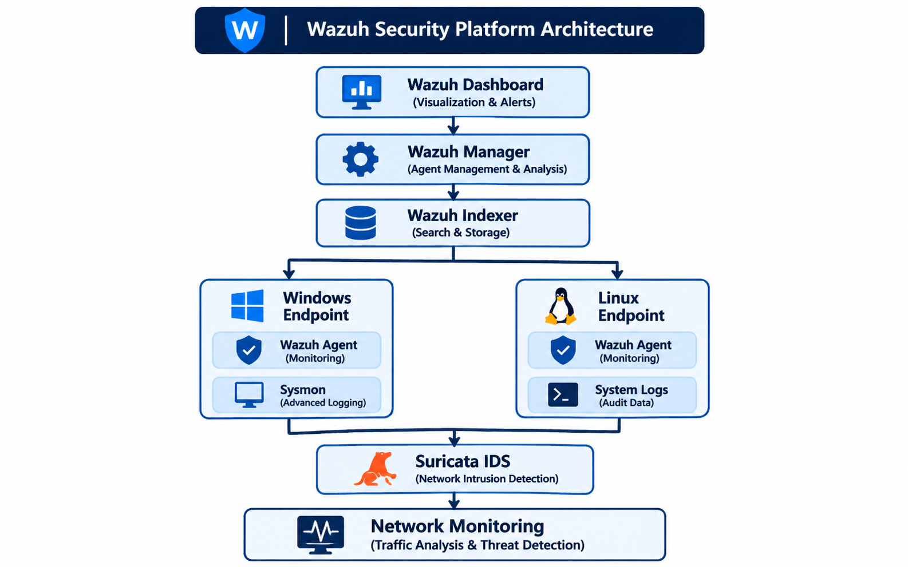

# 🛡️ SOC Monitoring Platform | Wazuh & Suricata

<p align="center">
  
  
  
  
  
</p>

<p align="center">
  <strong>A Practical Security Operations Center (SOC) Laboratory</strong>
</p>

---

## 📌 1. Project Overview

This project demonstrates the deployment and configuration of a defensive Security Operations Center (SOC) laboratory using **Wazuh SIEM** and **Suricata IDS**.

The main objective is to build a centralized security monitoring environment capable of collecting endpoint events, monitoring system activities, detecting suspicious network traffic, and supporting security investigations.

The laboratory integrates Windows and Linux endpoints with centralized security monitoring components to provide visibility into endpoint and network activities.

### 🎯 Project Objectives

- Deploy and configure a centralized Wazuh SIEM platform.
- Integrate Windows and Linux endpoints.
- Monitor security events across multiple operating systems.
- Configure File Integrity Monitoring (FIM).
- Collect and analyze Windows security events.
- Integrate Sysmon for enhanced Windows event visibility.
- Deploy Suricata for network intrusion detection.
- Analyze security alerts and investigate suspicious activities.
- Develop practical SOC monitoring and incident investigation skills.

---

## 🏗️ 2. SOC Architecture

The laboratory is designed around centralized security monitoring using Wazuh and Suricata.

### Architecture Diagram

The following diagram illustrates the architecture of the Security Operations Center (SOC) laboratory.

<p align="center">
  
</p>

<p align="center">
  <em>Figure 1: SOC Architecture – Wazuh SIEM, Windows and Linux Endpoints, Sysmon, and Suricata IDS.</em>
</p>

### Main Components

| Component | Description |
|---|---|
| Wazuh Dashboard | Security monitoring and alert visualization. |
| Wazuh Manager | Centralized agent management and security event analysis. |
| Wazuh Indexer | Security event storage and indexing. |
| Windows Endpoint | Generates Windows security events. |
| Linux Endpoint | Generates Linux system and security events. |
| Wazuh Agent | Forwards endpoint events to the Wazuh Manager. |
| Sysmon | Provides detailed Windows system activity events. |
| Suricata IDS | Monitors network traffic and generates intrusion detection alerts. |

---

## 🛠️ 3. Technologies & Tools

| Technology | Purpose |
|---|---|
| Wazuh | Security Information and Event Management (SIEM). |
| Suricata | Network Intrusion Detection System (IDS). |
| Sysmon | Windows system activity monitoring. |
| Linux | Server administration and monitoring. |
| Windows | Endpoint security monitoring. |
| VirtualBox | Virtual laboratory environment. |
| PowerShell | Windows administration. |
| Bash | Linux administration. |

---

## ⚙️ 4. Implementation

### 4.1 Wazuh SIEM Deployment

Deployment of the Wazuh platform, including:

- Wazuh Manager installation.
- Wazuh Indexer installation.
- Wazuh Dashboard configuration.
- Verification of Wazuh services.
- Access to the centralized monitoring interface.

### 4.2 Windows Endpoint Integration

Integration of a Windows endpoint with the Wazuh Manager.

**Activities:**

- Installation of the Wazuh Agent.
- Configuration of the Wazuh Manager address.
- Agent registration and connection verification.
- Windows security event collection.
- Security policy auditing.

### 4.3 Linux Endpoint Integration

Integration of a Linux endpoint with the Wazuh Manager.

**Activities:**

- Wazuh Agent installation.
- Manager address configuration.
- Agent service management.
- Linux system log monitoring.
- Agent connection verification.

### 4.4 Windows Security Monitoring

Configuration of Windows auditing policies to improve security event visibility.

**Monitored categories include:**

- Account Logon Events.
- Logon Events.
- Account Management.
- Process Management.
- Policy Change.
- Privilege Use.

### 4.5 File Integrity Monitoring (FIM)

File Integrity Monitoring is configured to monitor selected directories.

**Monitored paths:**

Windows:

```text
C:\SOC-Test\
```

Linux:

```text
/home/user/SOC-Test/
```

The objective is to identify file integrity changes and generate security events for investigation.

### 4.6 Sysmon Integration

Sysmon provides detailed information about Windows system activity.

It complements Windows event collection by providing additional information about processes and system events.

The collected events can be used for security monitoring and investigation.

### 4.7 Suricata IDS Deployment

Suricata is deployed as a network intrusion detection component.

**Main activities:**

- Suricata installation.
- Network interface configuration.
- Service management.
- Configuration of network monitoring.
- Analysis of generated alerts.

Suricata event information can be found in:

```bash
/var/log/suricata/eve.json
```

---

## 📊 5. Security Monitoring & Investigation

The laboratory focuses on defensive security monitoring through:

- Endpoint security event collection.
- Windows and Linux log analysis.
- File Integrity Monitoring.
- Network Intrusion Detection.
- Security alert investigation.
- Identification of suspicious activities.

---

## 📸 6. Screenshots & Evidence

Screenshots document the actual deployment and configuration of the SOC laboratory.

| Screenshot | Description |
|---|---|
| `wazuh-install.png` | Wazuh platform installation. |
| `agent_windows.png` | Windows Wazuh Agent. |
| `agent_linux.png` | Linux Wazuh Agent. |
| `audit_windows.png` | Windows audit policy. |
| `fim_config.png` | File Integrity Monitoring configuration. |
| `suricata_install.png` | Suricata installation. |
| `wazuh-dashboard.png` | Wazuh Dashboard. |

All screenshots are stored in the `screenshots/` directory.

---

## 📁 7. Repository Structure

```text
SOC-Wazuh-Suricata-Lab/
│
├── README.md
│
├── images/
│   └── architecture.png
│
├── screenshots/
│   ├── wazuh-install.png
│   ├── agent_windows.png
│   ├── agent_linux.png
│   ├── audit_windows.png
│   ├── fim_config.png
│   ├── suricata_install.png
│   └── wazuh-dashboard.png
│
├── configuration/
│   ├── wazuh/
│   ├── suricata/
│   └── sysmon/
│
└── documentation/
    ├── installation-guide.md
    └── configuration-guide.md
```

---

## 📚 8. Skills Demonstrated

This project demonstrates practical knowledge in:

- SIEM Deployment and Administration.
- SOC Operations.
- Blue Team Security.
- Security Event Monitoring.
- Log Analysis.
- Endpoint Monitoring.
- File Integrity Monitoring.
- Network Intrusion Detection.
- Windows Security Auditing.
- Linux System Administration.
- Security Event Investigation.

---

## 🔮 9. Future Improvements

Potential improvements for the laboratory include:

- Advanced Wazuh detection rules.
- MITRE ATT&CK mapping.
- Additional Windows event monitoring.
- Enhanced Suricata event integration.
- Automated security alert analysis.
- Incident response documentation.
- Security dashboards and reporting.

---

## 👨‍💻 10. Author

**Ahmed ELGHACHI**

Master's Graduate in Cybersecurity

**Focus Areas:**
- Cyber Defense
- SOC Operations
- Blue Team
- Cloud Security
- Network Security

**GitHub:** [Ahmed-Elghachi](https://github.com/Ahmed-Elghachi)

**Credly:** [Ahmed Elghachi](https://www.credly.com/users/ahmed-elghachi)

---

## ⚠️ Disclaimer

This project is developed for educational purposes and defensive cybersecurity learning in a controlled laboratory environment.

All monitoring and security testing activities must be conducted on systems and networks for which proper authorization has been obtained.

---

<p align="center">
  <strong>Building practical cybersecurity skills through defensive security engineering.</strong>
</p>
